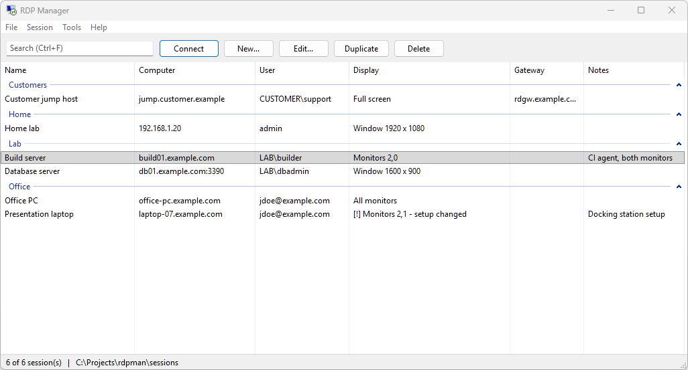
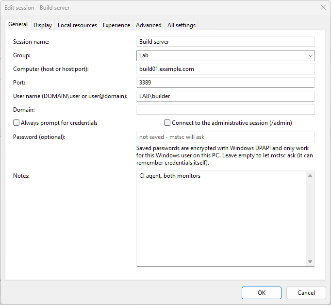
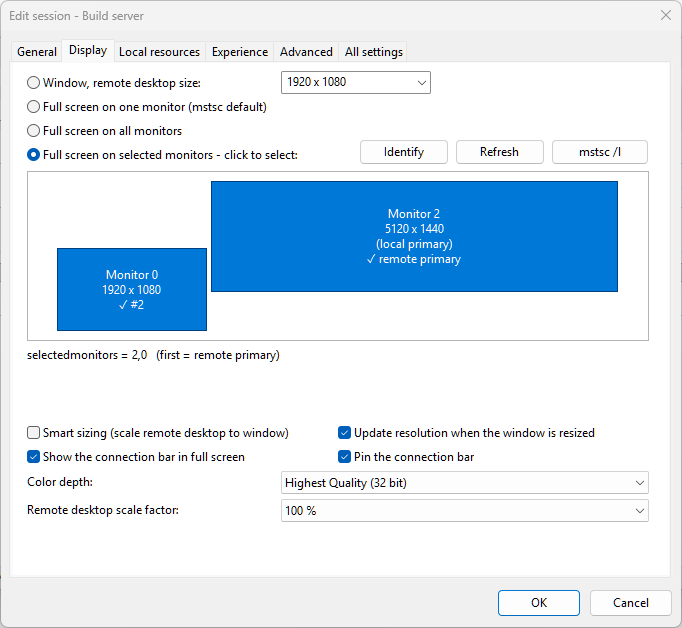
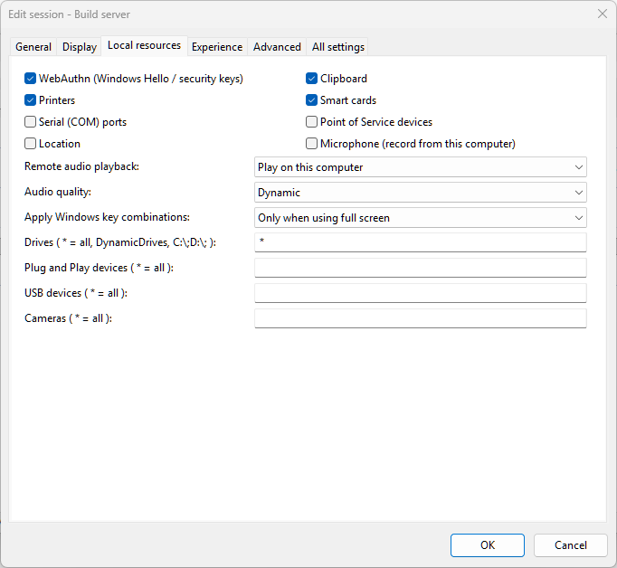
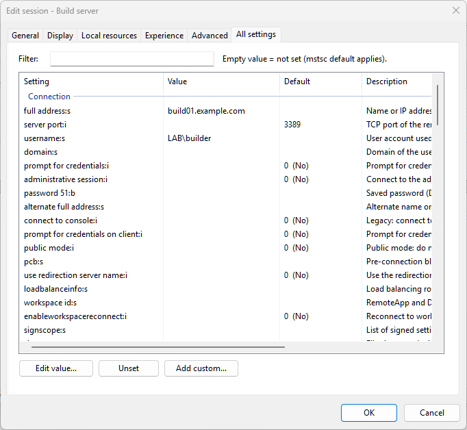

# rdpman

A small, portable manager for Windows Remote Desktop sessions.

It is a single native Win32 executable (about 320 KB) with no .NET or other runtime dependency and
no installer. Connections are opened with the Remote Desktop client that ships with Windows
(`mstsc.exe`), so everything `mstsc` supports keeps working.



## Features

- **Session list** with search, optional groups, and connect / new / edit / duplicate / delete.
- **Plain `.rdp` files as storage.** Each session is an ordinary `.rdp` file, so existing
  configurations can be used directly and nothing is locked into a private format.
- **All RDP settings.** Tabs for the common settings (general, display, local resources,
  experience, advanced) plus an "All settings" tab listing about 100 known RDP properties with
  defaults and descriptions. Any other `name:type:value` line can be added by hand.
- **Monitor selection for full screen.** The attached monitors are drawn in their real layout
  with the IDs `mstsc` uses; click the ones a session should use. The first one clicked becomes
  the primary monitor of the remote session.
- **Monitor change detection.** A session remembers the monitor layout it was set up for. If a
  monitor has been removed, its resolution or position changed, or the selected monitors are no
  longer adjacent, the session is marked in the list and you are warned before connecting.
- **Import and export** of `.rdp` files, including drag and drop.
- **Direct launch** from a shortcut or script: `rdpman.exe "session name"`.

## Getting it

Download `rdpman.exe` from the repository's releases, or from the artifacts of the latest build
under the Actions tab, and put it in any folder. It needs Windows 10 or later.

## Using it

Start `rdpman.exe`. Create a session with **New**, or bring in existing files (see below).
Double-click a session or press Enter to connect.

| Key | Action |
| --- | --- |
| Enter | Connect to the selected sessions |
| Ctrl+N / Ins | New session |
| F2 | Edit |
| Ctrl+D | Duplicate |
| Del | Delete (to the recycle bin) |
| Ctrl+F | Search; Esc clears it |
| Ctrl+I / Ctrl+E | Import / export |
| F5 | Reload the sessions folder |

### Connection settings

Editing a session opens a dialog with one tab per area. **General** holds the name, group,
computer, user and optional password:



**Display** selects window or full screen and, for full screen, which monitors to use:



**Local resources** controls clipboard, printers, drives, audio and other redirection:



**All settings** lists every known RDP property, set or not, and accepts custom lines:



### Where data is stored

Sessions are kept in a `sessions` folder next to the exe and window settings in `rdpman.ini`
beside it, so the folder can be copied to another PC or run from a USB stick. If the exe folder
is not writable, `%APPDATA%\rdpman` is used instead.

### Existing .rdp files

- **Import:** File > Import, drag files onto the window, or copy them into the `sessions` folder.
  Files in UTF-16, UTF-8 and ANSI encoding are read.
- **Export:** a single session (File > Export) or all sessions to a folder, as plain `.rdp` files.
- Lines the program does not know are kept unchanged, and settings a file does not contain are
  not added unless you change them.

Group, notes, extra `mstsc` arguments and the remembered monitor layout are stored in the session
file as lines starting with `rdpman`. They are removed from exported files and from the copy that
is passed to `mstsc`.

### Monitors

On the Display tab choose between a window, full screen on one monitor, full screen on all
monitors, or full screen on selected monitors. **Identify** flashes each monitor's ID on screen
and **mstsc /l** shows the list `mstsc` itself reports, for cross-checking. `mstsc` requires the
selected monitors to be adjacent; the picker warns if they are not.

When the monitor setup no longer matches a session, the list shows `[!]` in the Display column.
Connecting to a session with selected monitors then asks whether to connect with the monitors
that are still attached, pick monitors again, or cancel. Sessions set to "all monitors" are only
marked, since they use whatever is attached. Imported files have no remembered layout until they
are saved once in the editor; until then only a missing monitor or non-adjacent monitors are
detected.

### Passwords

A password can optionally be saved with a session. It is encrypted with Windows DPAPI, which
ties it to the Windows user and PC it was saved on, so it does not work after copying the folder
to another machine. Leaving the field empty lets `mstsc` ask and remember credentials itself.

## Building

Requires Visual Studio or the Build Tools with the C++ x64 toolset.

```
build.cmd
```

This produces `rdpman.exe` in the repository folder. The source is `rdpman.cpp` plus
`app.manifest`; there are no other dependencies.

GitHub Actions builds every push and pull request and uploads the exe as an artifact. Pushing a
tag that starts with `v` also publishes a release:

```
git tag v1.0.0
git push origin v1.0.0
```
